**1.1**
```
EXPLAIN (ANALYZE, BUFFERS)
SELECT f.flight_no, f.departure_airport, f.actual_departure
FROM flights f
JOIN airports a ON a.airport_code = f.departure_airport
WHERE a.city = 'Moscow' AND f.status = 'Arrived'
  AND f.actual_departure >= '2017-08-01' AND f.actual_departure < '2017-09-01'
ORDER BY f.actual_departure;
```

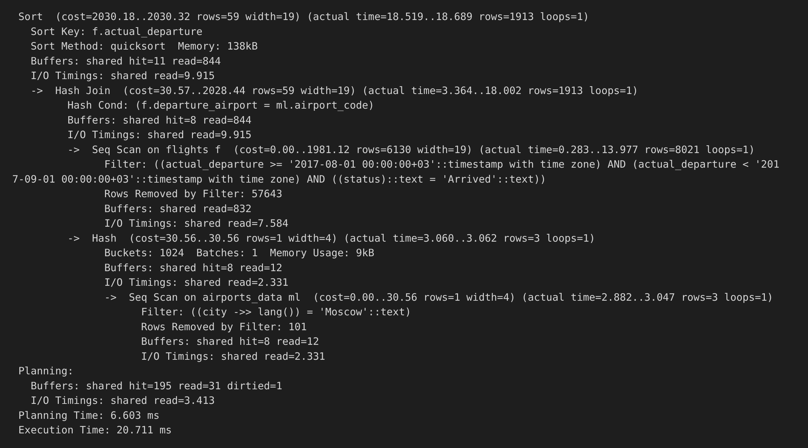

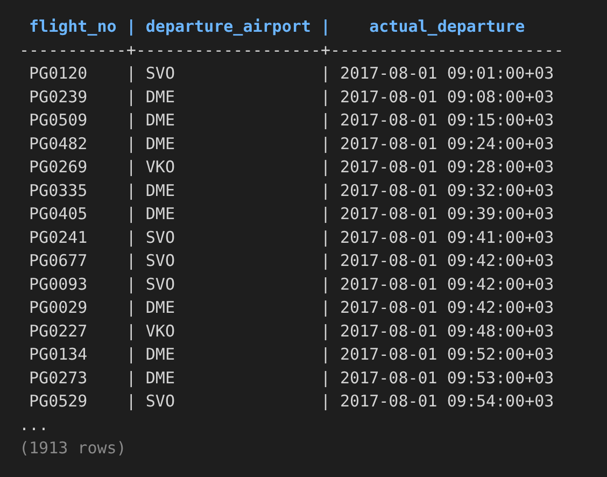

Каждый запрос запускала два раза, первый раз после перезапуска сервера, план выше от первого раза. Индекс не используется, на `flights` нет индекса ни по дате, ни по статусу, поэтому `Seq Scan` по всей таблице и `Hash Join` с аэропортами Москвы. В первый раз с диска прочитано 844 страницы (`read=844`), во второй всё было в кеше.

**1.2**
```
EXPLAIN (ANALYZE, BUFFERS)
SELECT flight_no, scheduled_arrival, actual_arrival,
  round(extract(epoch FROM actual_arrival - scheduled_arrival) / 60) AS delay_min
FROM flights
WHERE actual_arrival - scheduled_arrival > interval '2 hours'
ORDER BY delay_min DESC;
```

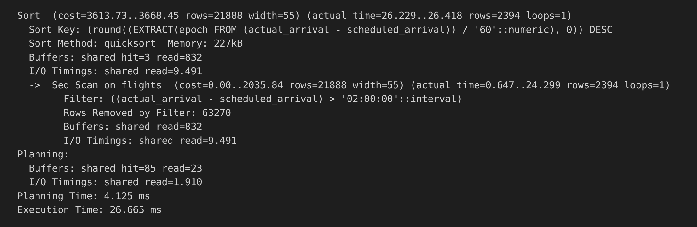

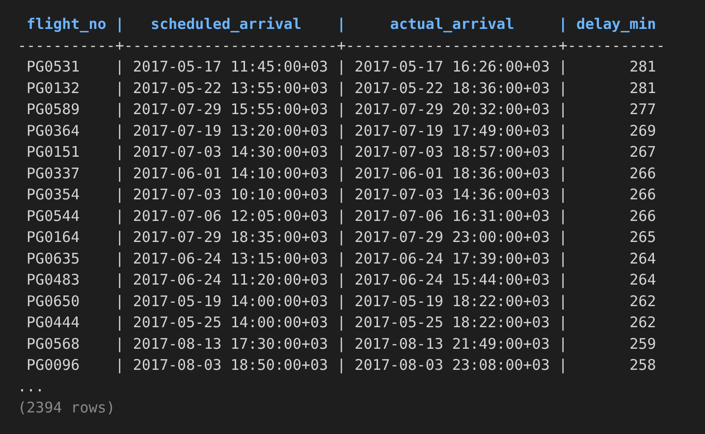

Индекс не используется, условие стоит на разности двух колонок, а не на самой колонке. `Seq Scan`, с диска прочитаны все 832 страницы, при повторном запуске всё из кеша. Планировщик ждал 21 888 строк, вышло 2394.

**1.3**
```
EXPLAIN (ANALYZE, BUFFERS)
SELECT flight_no, count(*) FILTER (WHERE status = 'Arrived') AS completed
FROM flights
WHERE flight_no >= 'PG0400' AND flight_no < 'PG0500'
GROUP BY flight_no
ORDER BY flight_no;
```

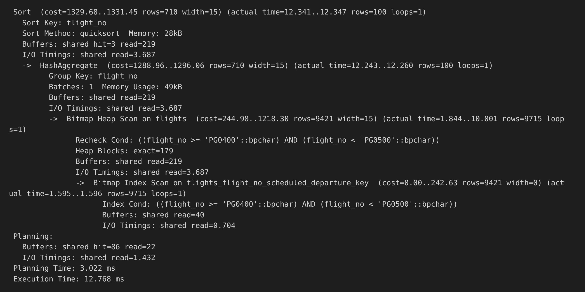


**1.3 LIKE**
```
EXPLAIN (ANALYZE, BUFFERS)
SELECT flight_no, count(*) FILTER (WHERE status = 'Arrived') AS completed
FROM flights
WHERE flight_no LIKE 'PG04%'
GROUP BY flight_no
ORDER BY flight_no;
```

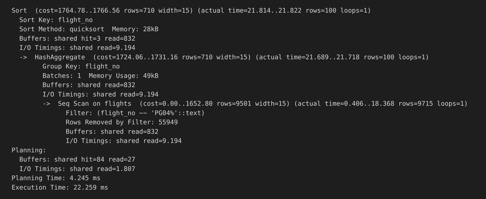

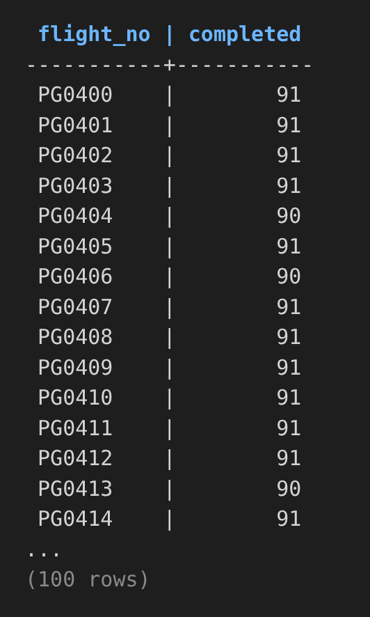

С диапазоном используется уже существующий индекс `(flight_no, scheduled_departure)`: `Bitmap Index Scan`, с диска 219 страниц (`read=219`) вместо 832. С `LIKE 'PG04%'` индекс не подхватился, `Seq Scan` по всей таблице (`read=832`). Результат одинаковый, поэтому оставила диапазон.

**2.1**
```
EXPLAIN (ANALYZE, BUFFERS)
SELECT f.departure_airport, a.airport_name, count(*) AS flights,
  round(avg(extract(epoch FROM f.actual_arrival - f.scheduled_arrival) / 60), 1) AS avg_arrival_delay_min
FROM flights f
JOIN airports a ON a.airport_code = f.departure_airport
GROUP BY f.departure_airport, a.airport_name
HAVING count(*) > 500
ORDER BY avg_arrival_delay_min DESC;
```

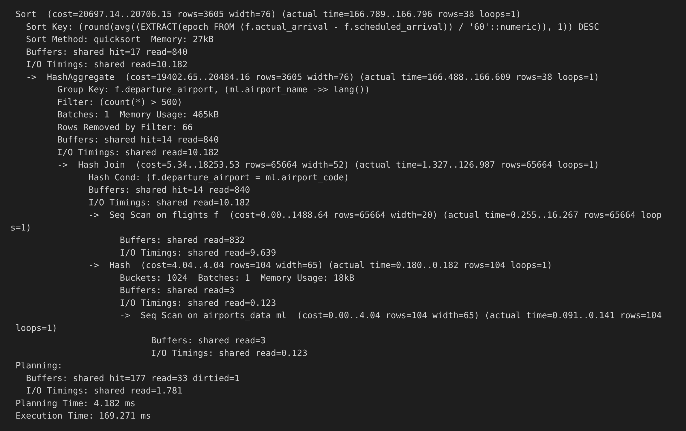

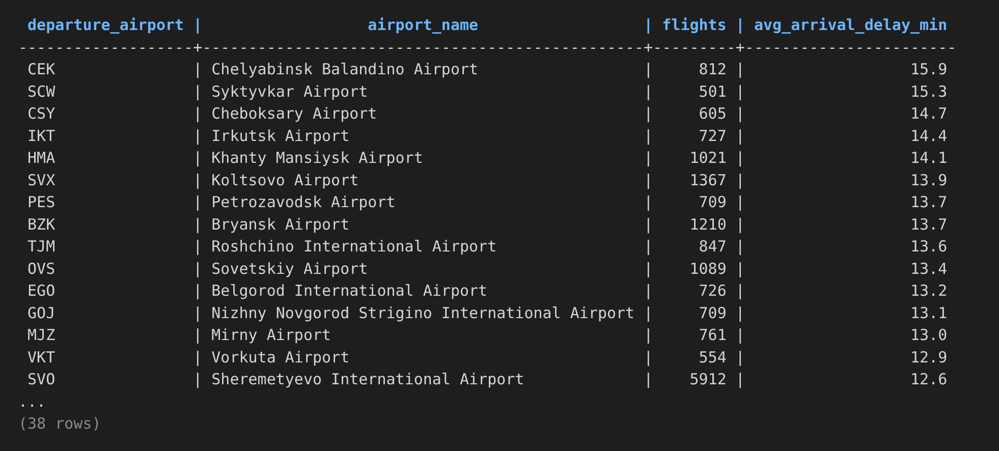

Индекс не используется, считаются все 65 664 рейса, `Seq Scan` по всей таблице. С диска 840 страниц, при повторном запуске всё из кеша. `HAVING` в плане это `Filter` у `HashAggregate`, отброшено 66 аэропортов из 104 (`Rows Removed by Filter: 66`).

**3.1**
```
EXPLAIN (ANALYZE, BUFFERS)
SELECT t.passenger_name, tf.amount, f.flight_no,
  dep.city AS departure_city, arr.city AS arrival_city
FROM ticket_flights tf
JOIN tickets t ON t.ticket_no = tf.ticket_no
JOIN flights f ON f.flight_id = tf.flight_id
JOIN airports dep ON dep.airport_code = f.departure_airport
JOIN airports arr ON arr.airport_code = f.arrival_airport
ORDER BY tf.amount DESC, tf.ticket_no
LIMIT 10;
```

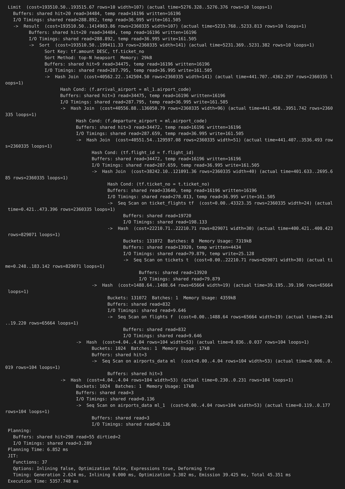

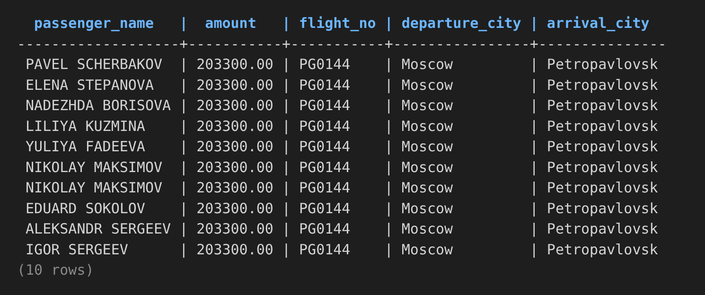

Самый долгий запрос, 5,4 с. С диска прочитано 34 484 страницы, и хеш по `tickets` не влез в память (`Batches: 8`), отсюда `temp read=16196 written=16196`. При повторном запуске страницы всё равно идут как `read`, таблицы большие и в кеше не держатся. Индексы не используются, соединяются все 2,36 млн строк ради 10.

Цена 203 300 у 939 билетов, поэтому в сортировке есть ещё `ticket_no`, иначе десятка может каждый раз получаться разной.

**3.1 быстрее**
```
EXPLAIN (ANALYZE, BUFFERS)
SELECT t.passenger_name, tf.amount, f.flight_no,
  dep.city AS departure_city, arr.city AS arrival_city
FROM (SELECT ticket_no, flight_id, amount
      FROM ticket_flights
      ORDER BY amount DESC, ticket_no
      LIMIT 10) tf
JOIN tickets t ON t.ticket_no = tf.ticket_no
JOIN flights f ON f.flight_id = tf.flight_id
JOIN airports dep ON dep.airport_code = f.departure_airport
JOIN airports arr ON arr.airport_code = f.arrival_airport
ORDER BY tf.amount DESC, tf.ticket_no;
```

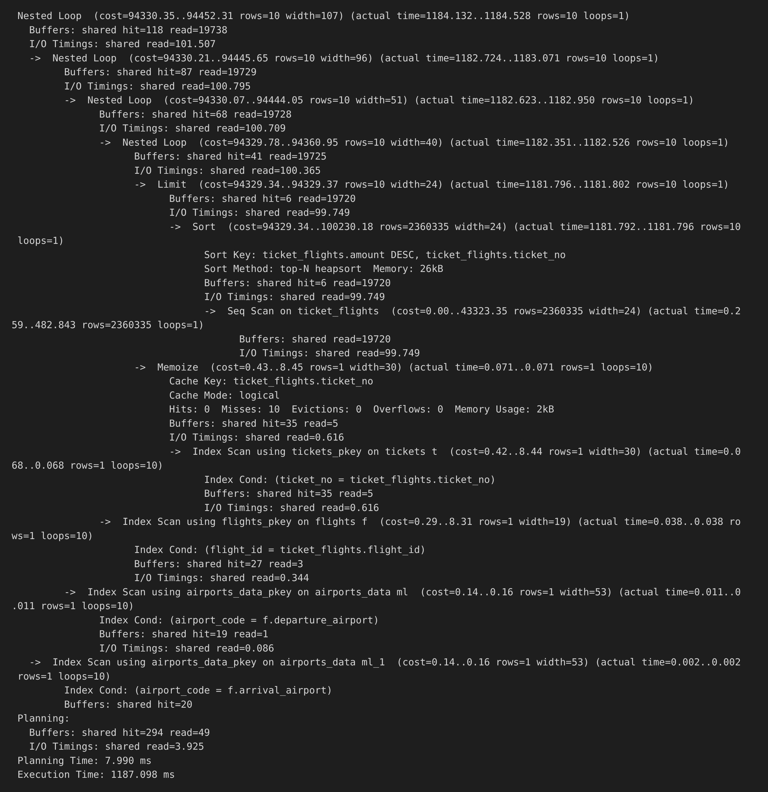


Сначала берутся 10 билетов, потом соединения. Результат тот же, 1,19 с вместо 5,36 с, временных файлов нет.

**3.2**
```
EXPLAIN (ANALYZE, BUFFERS)
SELECT a.airport_code, a.airport_name, a.city, count(f.flight_id) AS departures
FROM airports a
LEFT JOIN flights f ON f.departure_airport = a.airport_code
GROUP BY a.airport_code, a.airport_name, a.city
ORDER BY departures DESC, a.airport_code;
```

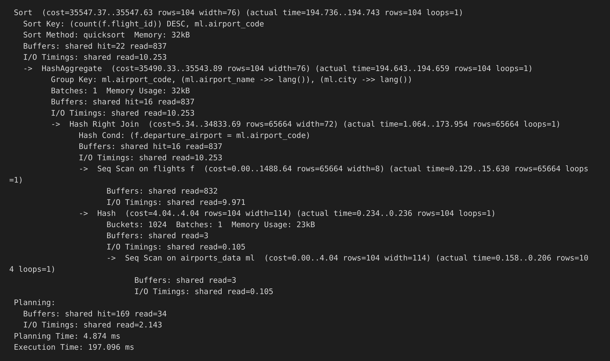

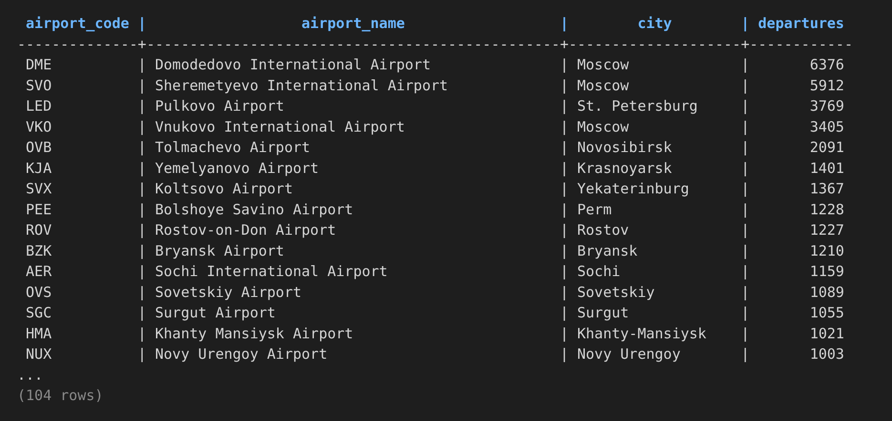

Индексы не используются, считаются все вылеты. С диска 837 страниц, при повторном запуске всё из кеша. `LEFT JOIN` в плане стал `Hash Right Join` (про него в задании 2). Аэропортов без вылетов в базе нет, но `count(f.flight_id)` дал бы им 0.

**3.3**
```
EXPLAIN (ANALYZE, BUFFERS)
SELECT t.passenger_id, t.passenger_name, count(*) AS flights, sum(tf.amount) AS total_spent
FROM tickets t
JOIN ticket_flights tf ON tf.ticket_no = t.ticket_no
GROUP BY t.passenger_id, t.passenger_name
ORDER BY total_spent DESC
LIMIT 5;
```

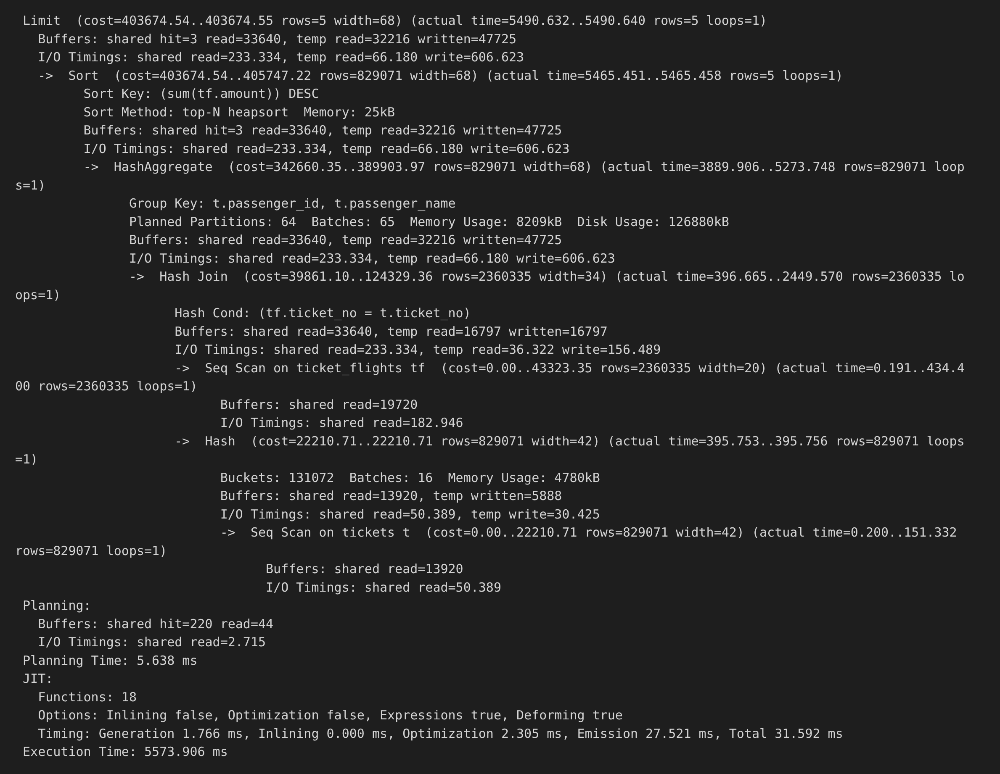

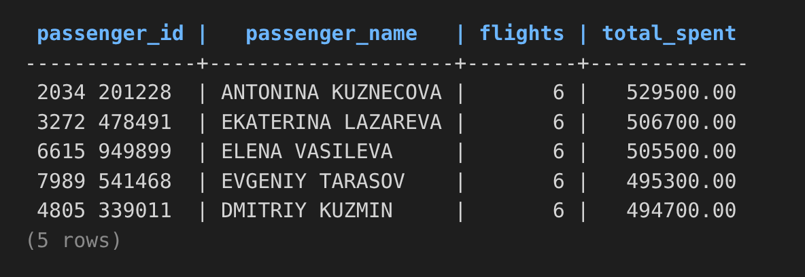

Группировка по 829 071 пассажиру не влезла в память, `HashAggregate` писал на диск (`Disk Usage: 126880kB`). С диска прочитано 33 640 страниц таблиц. Повторный запуск не быстрее, около 6 с, `tickets` и `ticket_flights` в кеше не остаются. Индексы не используются.

**1**
```
EXPLAIN (ANALYZE, BUFFERS)
SELECT date_trunc('month', book_date)::date AS month, sum(total_amount) AS revenue
FROM bookings
WHERE book_date >= '2017-01-01' AND book_date < '2018-01-01'
GROUP BY ROLLUP (date_trunc('month', book_date))
HAVING sum(total_amount) > 10000000000
  OR GROUPING(date_trunc('month', book_date)) = 1
ORDER BY month NULLS LAST;
```

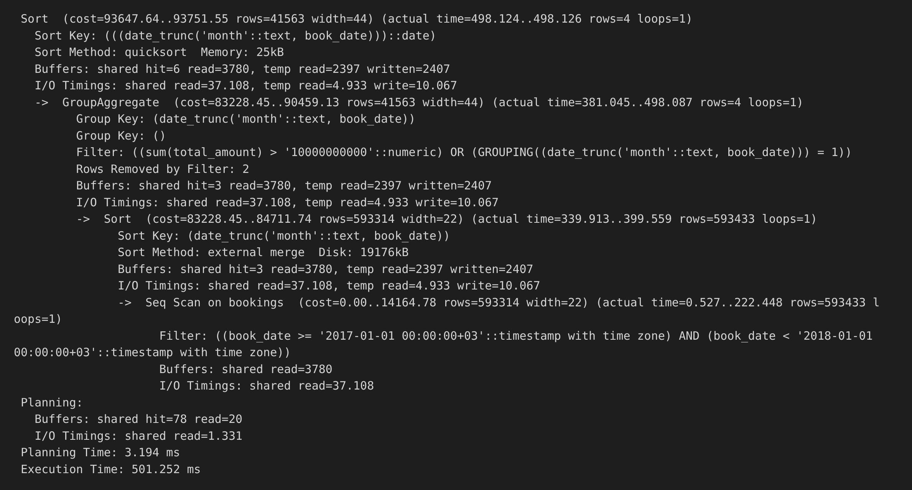

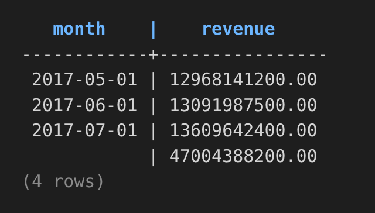

**1.** У `ROLLUP` две группировки: по месяцу и пустая `()`. В плане это две строки `Group Key` у `GroupAggregate`, `Group Key: ()` и есть общий итог.

**2.** `HAVING` проверяет уже посчитанные строки, и месяцы, и итог. В плане это `Filter` в том же `GroupAggregate`, убраны два месяца меньше 10 млрд (`Rows Removed by Filter: 2`).

**3.** Итоговая строка проходит, потому что в `HAVING` сравнивается сумма, а не месяц. `NULL` только в колонке месяца, а сумма там 47 млрд. `OR GROUPING(...) = 1` добавлено, чтобы итог оставался при любом пороге. Итог считается по всем месяцам, поэтому он больше суммы трёх показанных.

**4.** Индекс не используется, под условие попадает весь 2017 год. С диска прочитаны все 3780 страниц `bookings`, при повторном запуске они в кеше. Сортировка не влезла в `work_mem`: `external merge Disk: 19176kB`.

**2 ON**
```
EXPLAIN (ANALYZE, BUFFERS)
SELECT a.airport_code, a.airport_name, count(f.flight_id) AS arrived_flights
FROM airports a
LEFT JOIN flights f ON f.arrival_airport = a.airport_code AND f.status = 'Arrived'
GROUP BY a.airport_code, a.airport_name
ORDER BY arrived_flights DESC, a.airport_code;
```

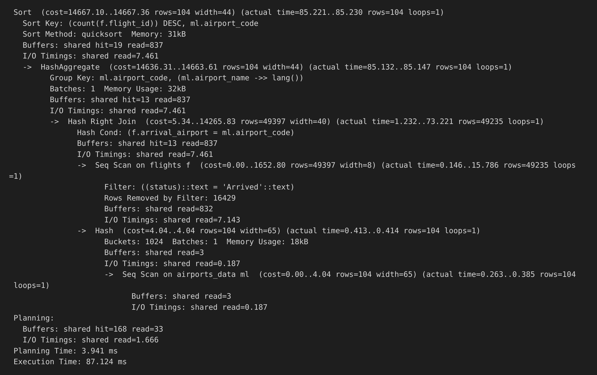

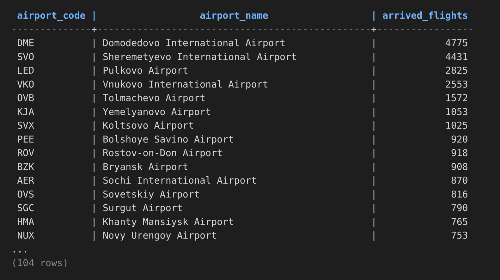

**2 WHERE**
```
EXPLAIN (ANALYZE, BUFFERS)
SELECT a.airport_code, a.airport_name, count(f.flight_id) AS arrived_flights
FROM airports a
LEFT JOIN flights f ON f.arrival_airport = a.airport_code
WHERE f.status = 'Arrived'
GROUP BY a.airport_code, a.airport_name
ORDER BY arrived_flights DESC, a.airport_code;
```

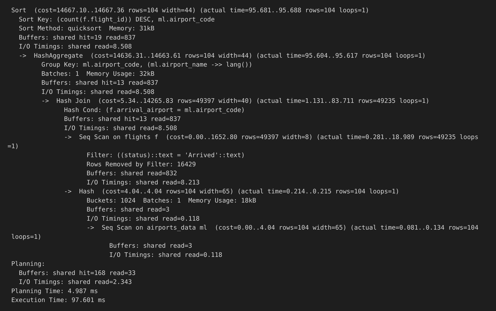


**2 за 15.08**
```
SELECT 'ON' AS где_условие, count(*) AS строк, count(*) FILTER (WHERE n = 0) AS с_нулём
FROM (SELECT a.airport_code, count(f.flight_id) AS n
      FROM airports a
      LEFT JOIN flights f ON f.arrival_airport = a.airport_code AND f.status = 'Arrived'
        AND f.actual_arrival >= '2017-08-15' AND f.actual_arrival < '2017-08-16'
      GROUP BY a.airport_code) x
UNION ALL
SELECT 'WHERE', count(*), count(*) FILTER (WHERE n = 0)
FROM (SELECT a.airport_code, count(f.flight_id) AS n
      FROM airports a
      LEFT JOIN flights f ON f.arrival_airport = a.airport_code
      WHERE f.status = 'Arrived'
        AND f.actual_arrival >= '2017-08-15' AND f.actual_arrival < '2017-08-16'
      GROUP BY a.airport_code) x;
```

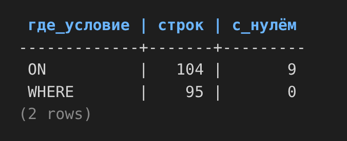

**2 COUNT(\*)**
```
SELECT a.airport_code, count(*) AS "COUNT(*)", count(f.flight_id) AS "COUNT(f.flight_id)"
FROM airports a
LEFT JOIN flights f ON f.arrival_airport = a.airport_code AND f.status = 'Arrived'
  AND f.actual_arrival >= '2017-08-15' AND f.actual_arrival < '2017-08-16'
GROUP BY a.airport_code
HAVING count(f.flight_id) = 0
ORDER BY 1;
```

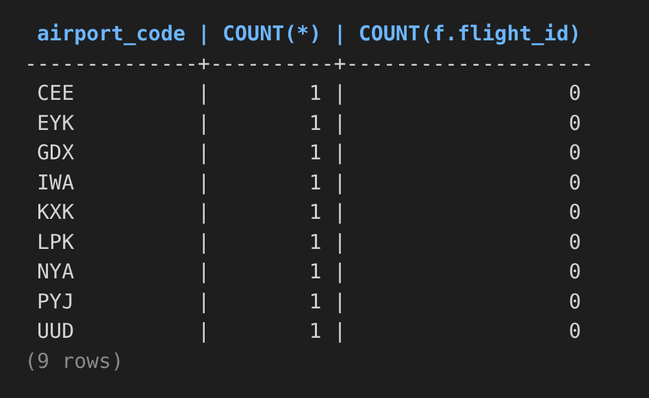

**1.** На всей базе `ON` и `WHERE` дают по 104 строки, в каждый аэропорт что-то прилетало. Разница только в плане: с `WHERE` вместо `Hash Right Join` обычный `Hash Join`, `LEFT JOIN` стал внутренним. Поэтому контрольный запуск за 15.08.2017: с `ON` 104 строки, у 9 аэропортов 0, с `WHERE` 95, эти 9 пропали.

**2.** У аэропорта без прилётов после `LEFT JOIN` остаётся одна строка, в которой вместо рейса `NULL`. `COUNT(*)` её посчитает и даст 1, `COUNT(f.flight_id)` `NULL` не считает и даёт 0. За 15.08 у всех 9 таких аэропортов так и вышло.

**3.** `Hash Right Join`: хеш строится по 104 аэропортам, рейсы идут через него. Сохранять по `LEFT JOIN` надо аэропорты, а в плане они правая сторона, поэтому Right. Результат такой же, как у `LEFT JOIN`.

**4.** Индекс не используется, по статусу его нет, а `Arrived` у большинства рейсов. Оба варианта прочитали с диска 837 страниц, при повторном запуске всё из кеша.

**3 EXTRACT**
```
EXPLAIN (ANALYZE, BUFFERS)
SELECT flight_id, flight_no, actual_departure
FROM flights
WHERE status = 'Arrived'
  AND EXTRACT(YEAR FROM actual_departure) = 2017
  AND EXTRACT(MONTH FROM actual_departure) = 8
  AND EXTRACT(DOW FROM actual_departure) IN (0, 6)
ORDER BY actual_departure;
```

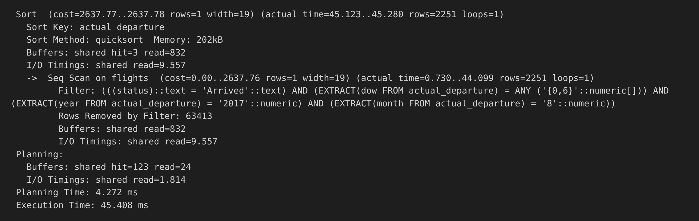


**3 диапазоны**
```
EXPLAIN (ANALYZE, BUFFERS)
SELECT flight_id, flight_no, actual_departure
FROM flights
WHERE status = 'Arrived'
  AND ((actual_departure >= '2017-08-05' AND actual_departure < '2017-08-07')
    OR (actual_departure >= '2017-08-12' AND actual_departure < '2017-08-14')
    OR (actual_departure >= '2017-08-19' AND actual_departure < '2017-08-21')
    OR (actual_departure >= '2017-08-26' AND actual_departure < '2017-08-28'))
ORDER BY actual_departure;
```

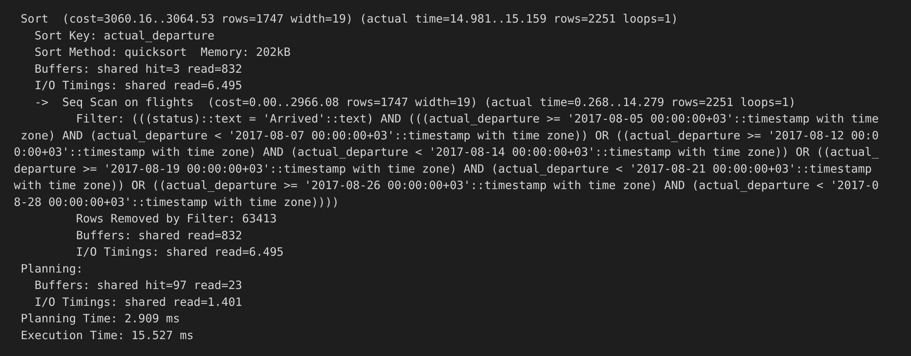

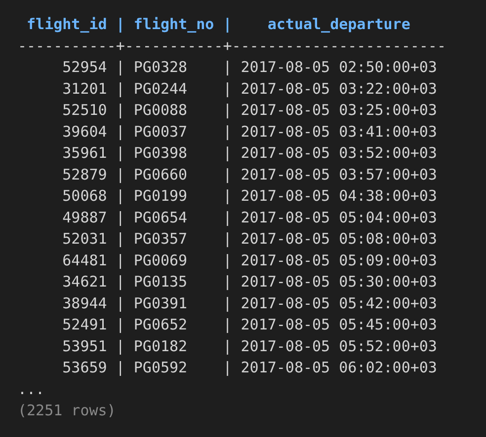

**3 индекс**
```
CREATE INDEX idx_flights_actual_departure ON flights (actual_departure);
ANALYZE flights;
```

**3 EXTRACT с индексом**

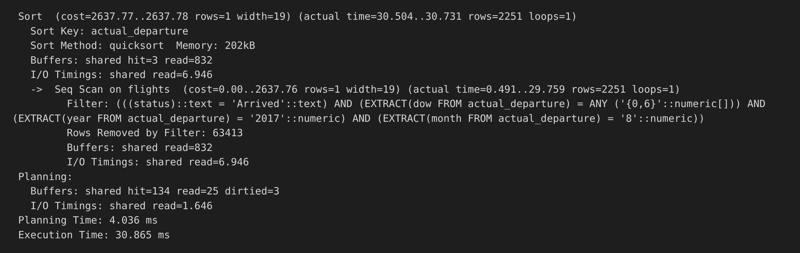

**3 диапазоны с индексом**

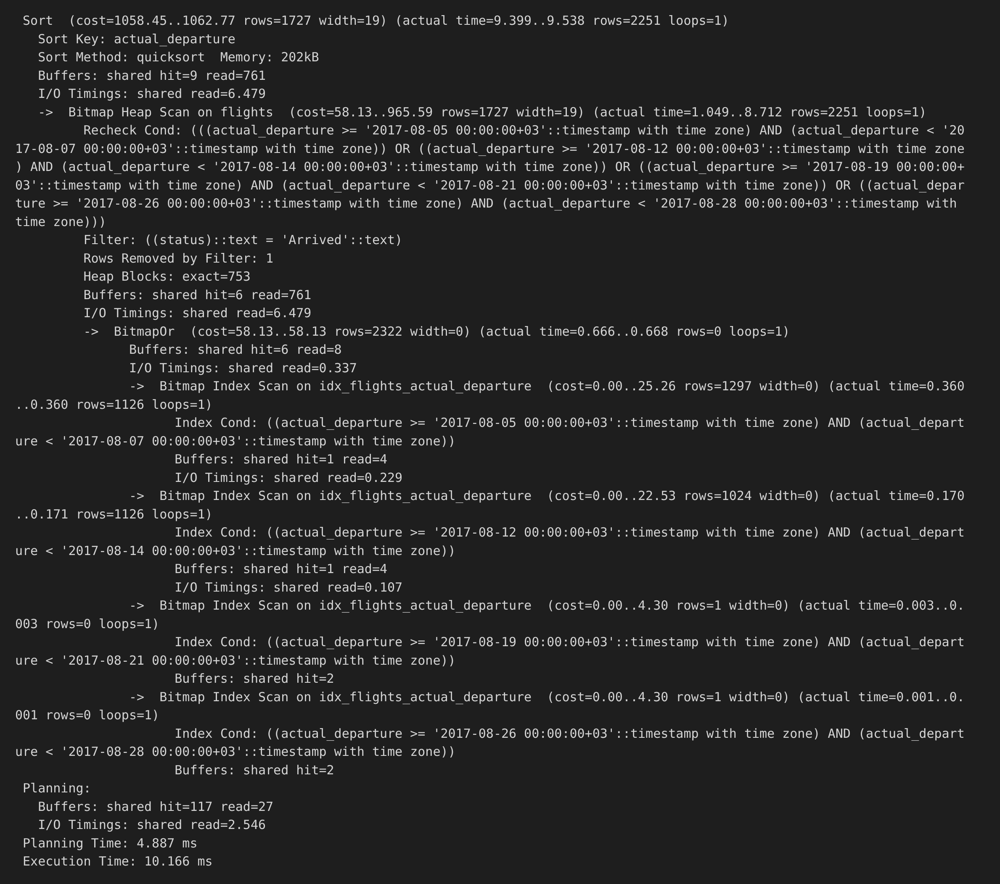

**1.** Оба запроса возвращают 2251 строку. Сначала запускала без индекса (по дате его на `flights` нет), потом создала `idx_flights_actual_departure` и повторила.

**2.** С `EXTRACT` индекс не используется и после создания: в индексе значения `actual_departure`, а не результат функции от них. Поэтому `Seq Scan`, и функция считается для каждой строки. С диапазонами колонка сравнивается прямо с датами, в плане 4 `Bitmap Index Scan` (по одному на выходные) и `BitmapOr`. Для `EXTRACT` планировщик ждал 1 строку (`rows=1`), для диапазонов 1727.

**3.** Время, первый / повторный запуск: `EXTRACT` без индекса 45,4 / 29,3 мс, диапазоны без индекса 15,5 / 14,6 мс, `EXTRACT` с индексом 30,9 / 25,4 мс, диапазоны с индексом 10,2 / 3,5 мс.

**4.** Без индекса оба читают с диска всю таблицу, 832 страницы, при повторном запуске из кеша. С индексом диапазоны прочитали 770 страниц, выигрыш небольшой, нужные рейсы разбросаны почти по всей таблице. `EXTRACT` индекс не использует.

**7 NOT IN**
```
EXPLAIN (ANALYZE, BUFFERS)
SELECT f.flight_id, f.flight_no, f.status
FROM flights f
WHERE f.flight_id NOT IN (SELECT tf.flight_id FROM ticket_flights tf
                          WHERE tf.fare_conditions = 'Business');
```

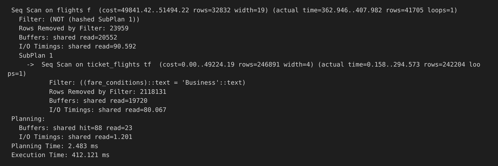

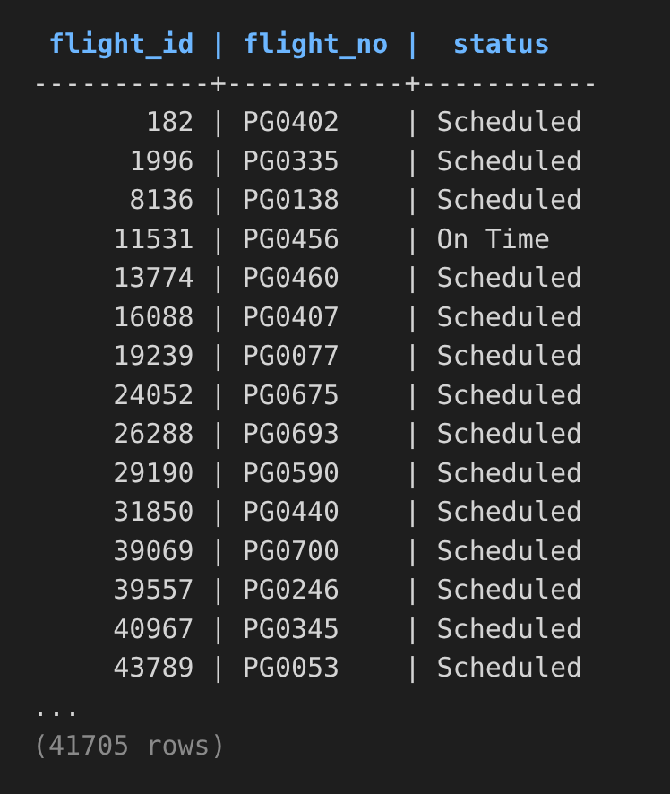

**7 NOT EXISTS**
```
EXPLAIN (ANALYZE, BUFFERS)
SELECT f.flight_id, f.flight_no, f.status
FROM flights f
WHERE NOT EXISTS (SELECT 1 FROM ticket_flights tf
                  WHERE tf.flight_id = f.flight_id AND tf.fare_conditions = 'Business');
```

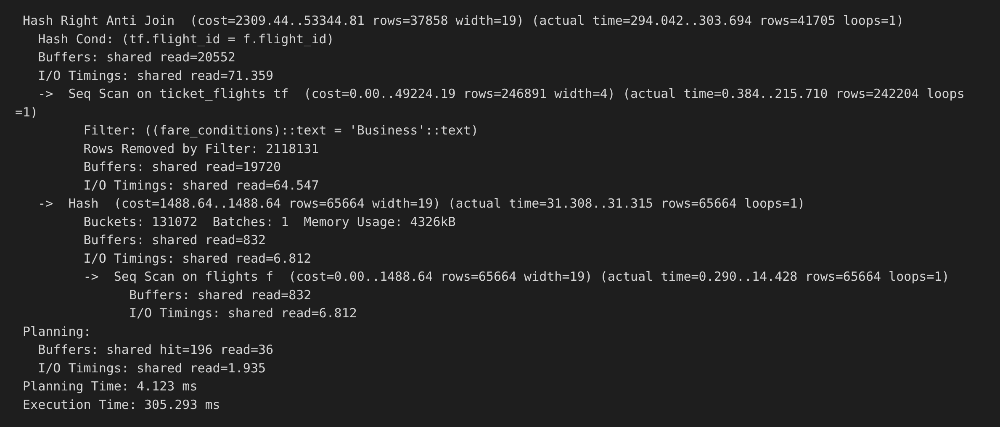

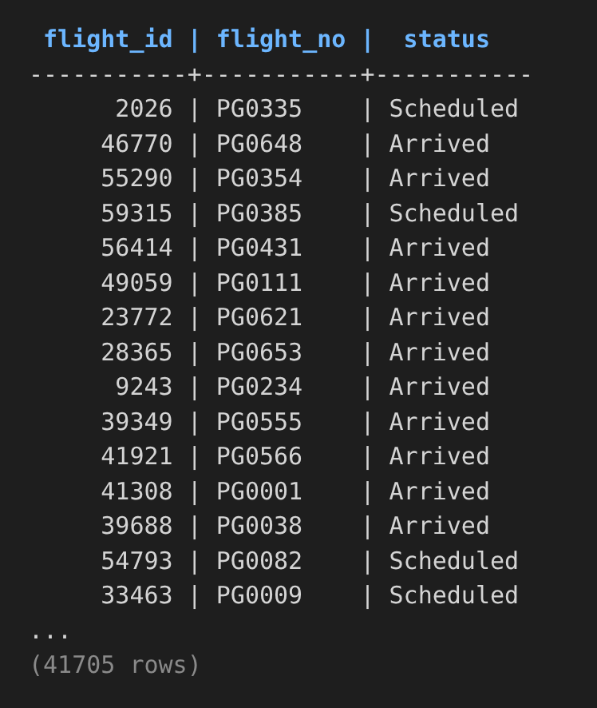

**7 NOT IN при work_mem = 64kB**
```
SET work_mem = '64kB';
EXPLAIN (ANALYZE, COSTS OFF, TIMING OFF)
SELECT f.flight_id FROM flights f
WHERE f.flight_id <= 50
  AND f.flight_id NOT IN (SELECT tf.flight_id FROM ticket_flights tf
                          WHERE tf.fare_conditions = 'Business');
```

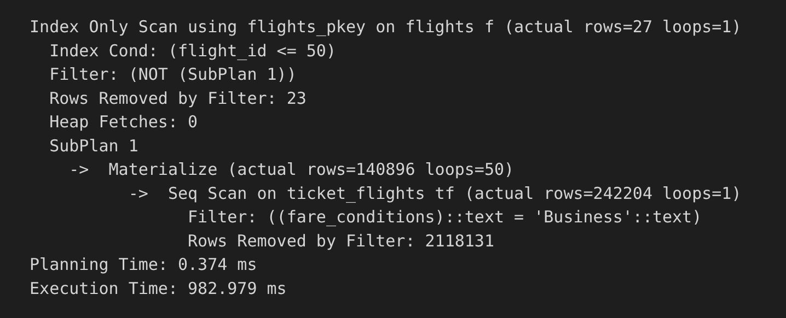

**7 NOT EXISTS при work_mem = 64kB**
```
SET work_mem = '64kB';
EXPLAIN (ANALYZE, COSTS OFF, TIMING OFF)
SELECT f.flight_id FROM flights f
WHERE NOT EXISTS (SELECT 1 FROM ticket_flights tf
                  WHERE tf.flight_id = f.flight_id AND tf.fare_conditions = 'Business');
```

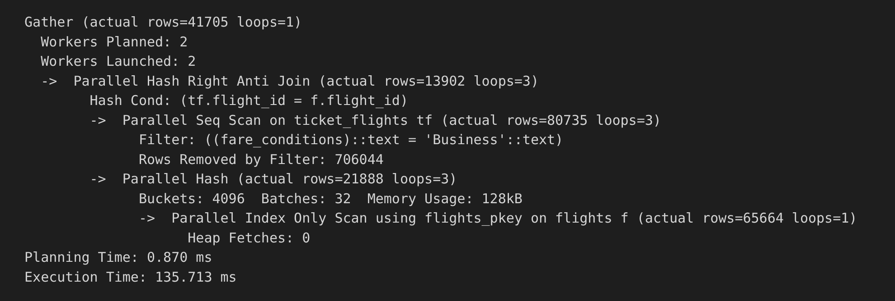

**7 NULL**
```
SELECT count(*) AS "NOT IN без NULL"
FROM flights f
WHERE f.flight_id NOT IN (SELECT tf.flight_id FROM ticket_flights tf
                          WHERE tf.fare_conditions = 'Business');
```

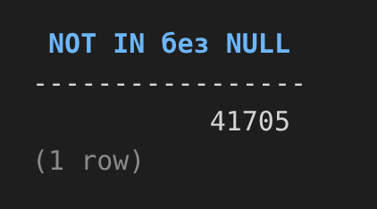

```
SELECT count(*) AS "NOT IN + один NULL"
FROM flights f
WHERE f.flight_id NOT IN (SELECT tf.flight_id FROM ticket_flights tf
                          WHERE tf.fare_conditions = 'Business'
                          UNION ALL SELECT NULL);
```

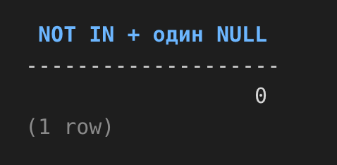

```
SELECT count(*) AS "NOT EXISTS + тот же NULL"
FROM flights f
WHERE NOT EXISTS (SELECT 1
                  FROM (SELECT tf.flight_id FROM ticket_flights tf
                        WHERE tf.fare_conditions = 'Business'
                        UNION ALL SELECT NULL) s
                  WHERE s.flight_id = f.flight_id);
```

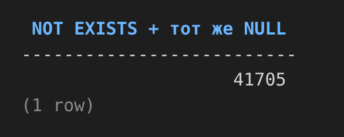

**1.** Оба запроса возвращают 41 705 рейсов. `NOT IN` 412 мс (повторно 384), `NOT EXISTS` 305 мс (повторно 291).

**2.** `NOT EXISTS` планировщик делает anti join, в плане `Hash Right Anti Join`. `NOT IN` так переделать нельзя из-за `NULL`, он остаётся фильтром с подзапросом: `Filter: (NOT (hashed SubPlan 1))`. Тут результат подзапроса влез в память и захешировался. С `work_mem = 64kB` хеша уже нет (`SubPlan 1` без `hashed`, `Materialize` с `loops=50`), подзапрос перебирается для каждой строки: 0,98 с всего на 50 рейсах. `NOT EXISTS` с теми же 64kB 136 мс на всех рейсах, хеш просто разбился на части (`Batches: 32`).

**3.** `x NOT IN (a, b, NULL)` это `x <> a AND x <> b AND x <> NULL`, последнее даёт `UNKNOWN`, и условие не бывает `TRUE`. Проверка: без `NULL` 41 705 строк, с одним `NULL` в подзапросе 0. `NOT EXISTS` с тем же подзапросом 41 705, он смотрит только, есть ли строка. Здесь `ticket_flights.flight_id` не может быть `NULL`, но в других таблицах может.

**4.** Индексы не используются, оба читают всю `ticket_flights` и `flights`, 20 552 страницы с диска. При повторном запуске `ticket_flights` всё равно идёт как `read`, она большая и в кеше не держится.

**8 до индекса**
```
EXPLAIN (ANALYZE, BUFFERS)
SELECT status, count(*)
FROM flights
GROUP BY status;
```

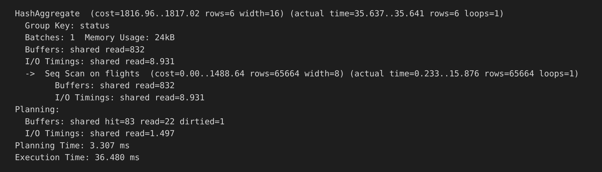

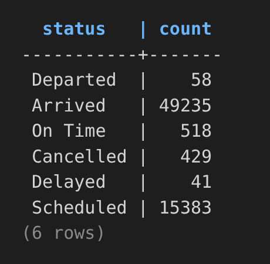

**8 индекс**
```
CREATE INDEX idx_flights_status ON flights (status);
VACUUM flights;
```

**8 после индекса**
```
EXPLAIN (ANALYZE, BUFFERS)
SELECT status, count(*)
FROM flights
GROUP BY status;
```

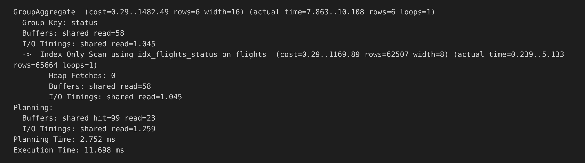

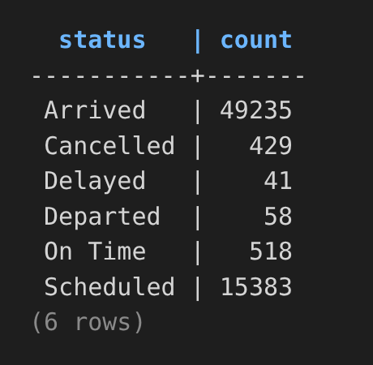

**8 после UPDATE**
```
UPDATE flights SET status = status WHERE flight_id % 10 = 0;
EXPLAIN (ANALYZE, BUFFERS)
SELECT status, count(*)
FROM flights
GROUP BY status;
```

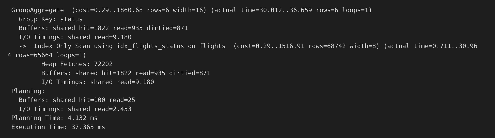

**8 после повторного VACUUM**
```
VACUUM flights;
EXPLAIN (ANALYZE, BUFFERS)
SELECT status, count(*)
FROM flights
GROUP BY status;
```


**1.** До индекса `Seq Scan` и `HashAggregate`, 832 страницы, 36,5 мс. После индекса и `VACUUM` `Index Only Scan` и `GroupAggregate`, 58 страниц, 11,7 мс. Из индекса строки идут уже отсортированными, хеш не нужен, поэтому и статусы на скриншоте по алфавиту.

**2.** `Index Only Scan` берёт `status` прямо из индекса и в таблицу не ходит (`Heap Fetches: 0`). Индекс 58 страниц, таблица 832, читать надо намного меньше.

**3.** По индексу не понять, видна ли строка, это хранится в таблице. Visibility Map отмечает страницы, где все строки видны всем, для них в таблицу ходить не надо. Отметки ставит `VACUUM`. После `UPDATE` каждой десятой строки стало `Heap Fetches: 72202`, запрос пошёл в таблицу почти за каждой строкой и стал медленнее, чем без индекса. После повторного `VACUUM` снова `Heap Fetches: 0`.

**4.** Без индекса с диска читается вся таблица, 832 страницы. С индексом прочитано только 58 страниц индекса, в таблицу запрос не ходил. При повторном запуске оба варианта из кеша.
